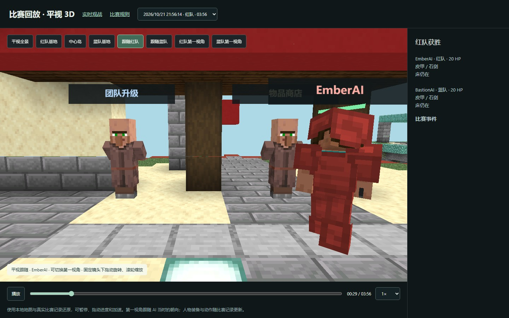

# MCAI · 悬空夺床

本地运行的 **Minecraft Java 1.21 起床战争 AI 对战**。真实 Paper 服务器负责规则与物理，每场两个 AI 用本地模型和公开策略比赛，支持原版客户端观战、平视网页观战和整局回放。对局不调用云模型 API。

当前版本 **0.7.0** 增加本地多竞技场排队、自动补位、结果去重与观战中心；沿用 0.6 的九岛地图、35 种商品、6 类团队升级。基地间距 112 格，包含南北钻石分路、前哨岛、双绿宝石点和高地通道。

## 运行

需要 Windows 10/11、JDK 21、Node.js 22+ 和 Python 3.11。首次安装会下载带摘要校验的服务器依赖与游戏资源。

```powershell
powershell -ExecutionPolicy Bypass -File .\setup-bedwars.ps1 -JavaHome '你的 JDK 21 目录'
```

阅读 [Minecraft EULA](https://www.minecraft.net/eula) 后，如同意，将本地 `runs/bedwars-local/eula.txt` 的 `eula=false` 改为 `eula=true`，再启动：

```powershell
powershell -ExecutionPolicy Bypass -File .\playtest.ps1 -NoBrowser
```

- [实时平视观战](http://127.0.0.1:3007/)
- [完整回放](http://127.0.0.1:3007/replays)
- [规则和商店](http://127.0.0.1:3007/rules)
- 原版画面：双击 `原版观战.cmd`，首次使用会下载官方 1.21 客户端资源。

详细安装、停止、手动参与与验证命令见 [本地试验指南](LOCAL_TRIAL.zh-CN.md)。客户端、服务器和本地录制不包含在仓库中。

## 给别人看

[Releases](https://github.com/xiao-zi-chen/MCAI/releases) 提供 `MCAI-showcase-0.6.0.zip` 展示包：解压后双击 `index.html`，即可离线观看完整比赛、精彩片段、地图截图与规则。MP4 视频也可以单独发送。接收者不需要安装 Minecraft。仓库保持私有，ZIP 可由所有者直接转发。



## 多竞技场与持续补位

已接入 **BullMQ + Redis**，一个 Minecraft 进程中使用三个独立世界。开局数量可调，已完成的场地保存结果、重置地图后独立接下一组。网页可以加入测试 AI、暂停新开局、调节并发、选择场地观战与回放。

停止旧演示后，首次准备和启动：

```powershell
powershell -ExecutionPolicy Bypass -File .\playtest.ps1 -Mode Stop
powershell -ExecutionPolicy Bypass -File .\scheduler.ps1 -Mode Prepare -JavaHome '你的 JDK 21 目录'
powershell -ExecutionPolicy Bypass -File .\scheduler.ps1 -Mode Start -RedisExe '你的 redis-server.exe 路径'
```

打开 [本地比赛中心](http://127.0.0.1:3009/)，点击“加入 4 个测试 AI”。后续启动不必重新 Prepare；自动补位模式由比赛中心分配选手，勿同时开启旧自动演示。

[0.7 运行、恢复与验证](docs/RELEASE_0.7.zh-CN.md) · [调度选型](docs/SCHEDULING_OPTIONS.zh-CN.md)。Agones 仍为后续多机器方案的配置示例。

## 内容和范围

- `competition/`：规则源文件、生成的商店/地图配置、参赛合同和动作 schema。
- `bedwars-map-plugin/`、`referee-plugin/`：原创地图、经济扩展、裁判和记录。
- `scripts/`、`models/showcase/`：两个示例 AI、权重、训练和验收工具。
- `local-scheduler/`：本机队列、竞技场调度、结果去重、比赛中心；仅接受内置测试策略。
- `local-viewer/`：实时观战与回放；默认平视，可切换第一视角。
- `bot-controller/`、`server-plugin/`、`python/`：保留的 PvP 训练核心。

独立演示中 Ember 偏快攻和拆床，Bastion 偏防守、升级和远程控制；并发测试会组合两套权重、两种打法和不同种子。每个近战 actor 为 22,027 参数；0.7 主要改造调度与场地隔离，没有重新训练网络。它们仍是示例对手，不能保证达到高手水平。

目前是双队 1v1。本项目提供参赛规则与合同草案；**AGX 正式后端接入和安全隔离的投稿运行器尚未完成**。不宣称复刻某个商业服务器的全部模式。

[0.6 改动与验证](docs/RELEASE_0.6.zh-CN.md) · [功能范围](docs/FEATURE_COVERAGE.zh-CN.md) · [模型说明](models/showcase/MODEL_CARD.zh-CN.md) · [第三方来源](docs/THIRD_PARTY.zh-CN.md)

基于 [Minecraft-PVP-ROBO](https://github.com/KyaKayKya/Minecraft-PVP-ROBO) 的 MIT 开放核心，保留原许可与历史。Minecraft / Mojang 资源由安装程序从官方服务获取。
