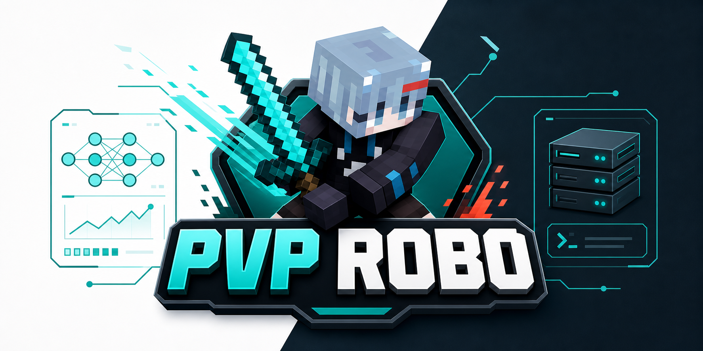

# PVP ROBO

<p align="center">
  
</p>

<p align="center">
  <strong>A Windows-first, no-render Minecraft PvP reinforcement-learning environment.</strong>
</p>

<p align="center">
  <a href="LICENSE"></a>
  
  
  
</p>

PVP ROBO is an open research stack for training and evaluating Minecraft PvP agents on private local servers. It connects a headless PaperMC server, a custom Paper plugin, Mineflayer-controlled bots, and a Gymnasium-compatible Python environment through persistent localhost protocols.

The project is built for efficiency and reproducibility: structured observations, flat `np.float32` vectors, integer action arrays, in-place episode reset, mock-first tests, and Windows PowerShell scripts for setup, training, evaluation, and smoke runs.

This repository is for private local/offline research servers only. Do not use it for public-server cheating, anticheat bypassing, stealth automation, or evasion.

## Updates

| Date | Highlights |
| --- | --- |
| 2026.07.17 | Added through-wall hit rejection, real line-of-sight snapshots, vanilla-effective damage ticks, and native Paper hit registration for human attacks. Thanks to [励励lili](https://space.bilibili.com/383268814), [MistWhy](https://space.bilibili.com/2129888402), and [科琳Colleen](https://space.bilibili.com/355912988) for reporting combat-rule issues. |
| 2026.07.15 | Released local AI Battle spectating docs and Champion ROBO preflight flow. |
| 2026.07.12 | Published the initial public local PvP RL stack with BC and Champion checkpoints. |

## What Is Inside

```text
server-plugin/        Paper plugin for privileged state, arena reset, and episode control
bot-controller/       Mineflayer headless bot controller
python/               Gymnasium env, protocols, BC/PPO tooling, evaluation, and tests
scripts/              Windows PowerShell setup, build, run, train, and eval tools
configs/              Safe local defaults and example manifests
docs/                 Architecture, protocol, training, runbook, and troubleshooting notes
```

Private deployment assets, maps, skins, signed textures, live server operations, generated worlds, and downloaded third-party binaries are intentionally not included. The repository does include two small released checkpoints for quick reproduction: a BC baseline and the current Champion ROBO PPO policy.

## Quick Start

Requirements:

- Windows 10 or later
- Java 21
- Gradle 8.x
- Node.js 22.x and npm
- Python 3.11+
- `uv`

Install Python and Node dependencies:

```powershell
powershell -NoProfile -ExecutionPolicy Bypass -File .\scripts\setup-python-env.ps1
npm.cmd --prefix bot-controller install
```

Build everything:

```powershell
powershell -NoProfile -ExecutionPolicy Bypass -File .\scripts\build-all.ps1 `
  -JavaHome "<JDK 21 path>" `
  -GradleHome "<Gradle path>"
```

Try the released checkpoints:

```powershell
.\.venv\Scripts\python.exe -m mc_pvp_env.duel_policy_manifest `
  --manifest configs\duel-policies.example.json preflight --difficulty bc

.\.venv\Scripts\python.exe -m mc_pvp_env.duel_policy_manifest `
  --manifest configs\duel-policies.example.json preflight --difficulty champion
```

Watch Champion ROBO fight the BC baseline on a local private worker:

```powershell
powershell -NoProfile -ExecutionPolicy Bypass -File .\scripts\test-ai-battle-live.ps1 `
  -WorkerId 1 `
  -StartWorker `
  -AcceptEula `
  -LeftDifficulty champion `
  -RightDifficulty bc
```

`-AcceptEula` writes `eula=true` only when explicitly passed. Use it only if you agree to Mojang's Minecraft EULA.

To watch from a Minecraft client instead of only running a smoke script, use [Local AI Battle Spectating](docs/wiki/local-ai-battle.md). It shows how to start worker 1, run the duel daemon, join with Minecraft Java Edition 1.21 at `127.0.0.1:25566`, open the in-game AI Battle menu, and recover if you spawn away from the arena or see the wrong game mode.

Start a local worker and run 100 random actions:

```powershell
powershell -NoProfile -ExecutionPolicy Bypass -File .\scripts\start-worker.ps1 `
  -WorkerId 0 `
  -JavaHome "<JDK 21 path>" `
  -GradleHome "<Gradle path>" `
  -NodeHome "<Node path>" `
  -AcceptEula `
  -Steps 100
```

`-AcceptEula` writes `eula=true` only when explicitly passed. Use it only if you agree to Mojang's Minecraft EULA. You can also edit `runs\worker_000\eula.txt` manually.

Stop the worker:

```powershell
powershell -NoProfile -ExecutionPolicy Bypass -File .\scripts\stop-workers.ps1 -WorkerId 0
```

## Python API

```python
import mc_pvp_env

env = mc_pvp_env.make_env("configs/default-env.json")
obs, info = env.reset()

for _ in range(100):
    action = env.action_space.sample()
    obs, reward, terminated, truncated, info = env.step(action)
    if terminated or truncated:
        obs, info = env.reset()

env.close()
```

The primary API returns Gymnasium-style `(obs, reward, terminated, truncated, info)` tuples. Observations are flat `np.float32` arrays; richer snapshots stay in `info`, debug paths, and tests.

## Training And Evaluation

Collect scripted demonstrations:

```powershell
powershell -NoProfile -ExecutionPolicy Bypass -File .\scripts\collect-demos.ps1 `
  -WorkerId 0 -Episodes 5 -Seed 123 -MaxStepsPerEpisode 40 `
  -Out runs\worker_000\demos\smoke
```

Train a small behavior-cloning policy:

```powershell
powershell -NoProfile -ExecutionPolicy Bypass -File .\scripts\train-bc.ps1 `
  -Data runs\worker_000\demos\smoke `
  -Out runs\worker_000\bc\smoke `
  -Epochs 1 -BatchSize 256 -HiddenSize 128 -Seed 123
```

Run a short PPO smoke:

```powershell
powershell -NoProfile -ExecutionPolicy Bypass -File .\scripts\start-ppo-training.ps1 `
  -WorkerId 0 -AcceptEula -Rebuild -TotalTimesteps 2000 -Tui
```

Generated runs, downloaded jars/tools, datasets, and new local checkpoints stay gitignored by default. The intentionally released checkpoints live under `checkpoints/`.

## Documentation

- [Docs index](docs/README.md)
- [Architecture overview](docs/wiki/overview.md)
- [Runbook](docs/wiki/runbook.md)
- [Local AI Battle spectating](docs/wiki/local-ai-battle.md)
- [RL training](docs/wiki/rl-training.md)
- [Released checkpoints](docs/wiki/released-checkpoints.md)
- [JSONL protocol](docs/wiki/protocol.md)
- [Troubleshooting](docs/wiki/troubleshooting.md)

## Project Status

The public core has verified unit tests for protocol parsing, action encoding, observation flattening, manifest tooling, and mock environment behavior. The last open-core verification also completed plugin build, bot tests, Python tests, a 100-step local worker smoke, BC smoke, and PPO smoke. See [open-core verification](docs/open-source/open-core-verification.md).

## License

PVP ROBO is released under the [MIT License](LICENSE).
