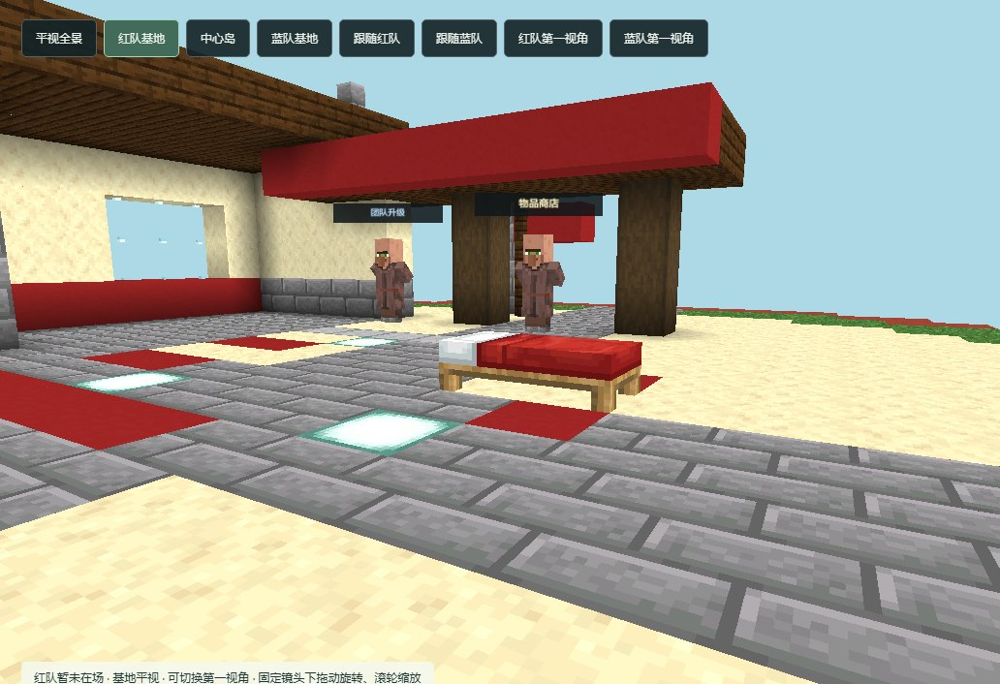

# 0.7.1：多进程测试、可靠录像与世界物品显示

本版将竞技场按配置分配到多个独立 Paper 服务，AI、控制连接、观战与录像目录都路由到对应服务。一个协调器仍负责排队和独立补位；服务故障时停止向对应场地分配。比赛中心显示每个服务的并发与延迟。默认 Windows 单进程用法保留，Linux 增加私有依赖准备和整组资源限额启动。

## 修复

- 网页显示两张床的真实半块、朝向和纹理；拆床、重置及回放跳转时更新。掉落物来自服务器实体快照，支持钻石、绿宝石、铁锭、金锭与堆叠、拾取、消失；旧录像缺失的掉落物不伪造。
- 长录像按有限批次在后台写入，结束时流式合并、刷盘并替换文件；协调器读取小摘要，验收逐帧扫描。修复旧实现结束时构造整场 JSON 引发的堆内存耗尽。
- AI 观察连接省去仅用于观战的几何数据，决策输入和比赛规则不变。
- 采样记录实际对战人数、每个服务的 tick 窗口、AI 决策频率、事件循环、CPU 配额和内存。主机与本项目内存余量分别保护，开局错峰。压测进程锁持有到录像验收结束，避免上一轮仍在写报告时下一轮抢改容量。
- 观战按实际服务显示游戏端口；较大的绘图脚本和方块状态 JSON 支持 gzip 传输。此最后的传输优化未继续进行游戏压测。

## 实测结论与限制

| 运行方式 | 实际峰值 | 短时验收 | 比赛与收尾 |
| --- | ---: | --- | --- |
| 单进程普通容量测试，3 核 / 9 GiB | 32 AI | 16、24 通过；32 未通过 | 21 场自然完成并释放 |
| 单进程超载探索，3 核 / 9→10 GiB | 62 AI | 32、48、64 目标未通过 | 62 场自然完成；观战请求超时 |
| 三进程普通容量测试，3 核 / 10 GiB | 38 AI | 48 目标未通过 | 19 场自然结束、2 场明确中止，全部释放 |
| 三进程超载探索，3 核 / 10 GiB | 48 AI | 未通过；满载 MSPT 中位 54.16ms | 29 场自然结束、19 场按要求中止；1 场保存后重置超时，未释放 |

三进程的 48 AI 阶段实际使用了多个 CPU 核，但在此总配额下仍出现 CPU 限流和 tick 延迟。观战浏览器加载地形超时，因此不能宣称通过了 48 人流畅对战或满载观战验收。重置超时的场地保守隔离；原因尚需后续单独复现。本次按所有者要求结束测试并清理远端环境。

本版未重新训练网络，仍使用两个 22,027 参数近战模型以及现有宏观策略、不同种子。增加参赛实例不等于增加独立训练模型。AGX 正式后端和任意投稿的安全隔离运行器仍不在本版范围内。

## 校验与证据

修改过程中完成 30 项调度、路由、故障隔离、资源、压力报告、世界物品和录像校验检查；Java 插件构建通过。后台录像检查在 32 MiB Java 堆限制下写出超过 150 MiB、20,000 帧记录，并覆盖空录像与写入失败。最后一轮的 48 份完整录像逐帧身份检查通过；场地释放异常如实保留，不混同于录像成功。

详细命令、门槛和测量说明见 [服务器测试指南](SERVER_TEST.zh-CN.md)，各轮摘要见 [2026-10-22 测量数据](benchmarks/2026-10-22.json)。本地保留报告、日志、状态及所选完整录像的压缩备份；源码仓库不包含口令、服务器数据目录、第三方游戏 JAR 或资源缓存。

清理核对：远端专属目录已删除，无本项目进程、监听端口或临时 systemd 服务；清理前记录的 30 个原有监听地址全部保留，磁盘空闲增加约 15 GiB。
